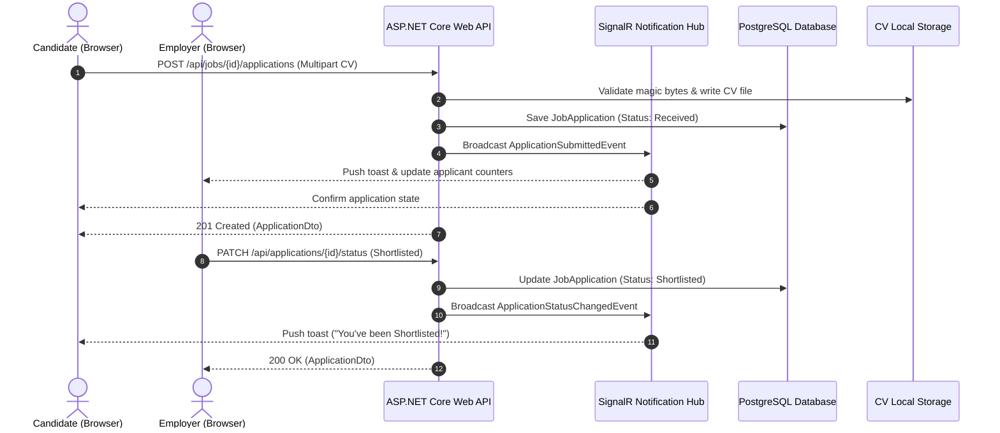

# 01. Project Overview

## 1. Executive Summary

**SkillBridge** is a modern, full-stack, skills-first talent marketplace and hiring management web application. Unlike traditional job boards that rely on unstructured text matching, keyword stuffing, or opaque machine-learning filters that disadvantage capable candidates, SkillBridge treats technical and domain skills as primary relational entities with explicit proficiency ratings, experience levels, and requirement weights.

The platform provides a dual-sided workflow for **Candidates** (job seekers) and **Employers** (hiring managers and recruiters), powered by a deterministic, multi-factor compatibility scoring engine (0–100%). It features a live applicant tracking pipeline, instant bidirectional notifications via SignalR WebSockets, automated job expiration, and security-hardened account management.

---

## 2. The Problems SkillBridge Solves

### Problem 1: Keyword Stuffing and Opaque ATS Filtering
In traditional recruitment systems, applicant tracking systems (ATS) screen candidate resumes using basic string matching. Candidates who lack arbitrary keywords are rejected, while those who game the algorithm with keyword stuffing advance regardless of competence.

**The SkillBridge Solution:**
- Standardized, curated skill taxonomy where skills are first-class entities (`Skill` with normalized names).
- Candidates declare specific proficiencies (`Beginner`, `Intermediate`, `Advanced`, `Expert`) and years of experience.
- Employers specify exact minimum required proficiencies and distinguish between **Must-Have (Required)** skills and **Nice-To-Have (Preferred)** skills.
- The matching engine mathematically calculates compatibility scores based on skill presence, proficiency multipliers, experience level alignment, work arrangement suitability, and geographic proximity.

### Problem 2: Asynchronous Delay & Lack of Status Transparency
Candidates often submit job applications into an "information black hole," never knowing if their application was received, reviewed, or rejected. Employers struggle to track candidate pipelines without expensive third-party tools.

**The SkillBridge Solution:**
- Real-time event streaming powered by ASP.NET Core SignalR.
- Employers receive instant push toasts and live counter updates when a new candidate applies.
- Candidates receive instant notifications the moment an employer updates their application status from `Received` to `Shortlisted` or `Rejected`.
- Candidates retain control with one-click withdrawal while their application remains in `Received` status.

### Problem 3: Outdated Postings & Uncontrolled Job Edits
Traditional platforms leave expired job postings active indefinitely, wasting candidate effort. Employers frequently edit job requirements midway through a recruitment cycle, invalidating earlier applications.

**The SkillBridge Solution:**
- Built-in **2-Hour Job Editing Rule:** Employers can fine-tune a posting within 2 hours of creation. After 2 hours, the job requirements are locked to protect applicant integrity.
- Automated background worker (`JobExpirationWorker`) runs every 15 seconds to check application deadlines, gracefully closing expired postings and broadcasting real-time closure events across connected clients.

---

## 3. Target User Personas & Roles

The system supports two core user roles defined in `SkillBridge.Domain.Common.Roles`:

### Persona A: The Candidate (`Roles.Candidate`)
- **Who they are:** Software engineers, healthcare practitioners, financial analysts, project managers, educators, and domain professionals looking for roles matching their exact competencies.
- **Key Goals:**
  - Discover opportunities filtered and ranked by mathematical compatibility rather than arbitrary search algorithms.
  - Understand precisely *why* they matched a role through detailed score breakdowns (Required Skills, Preferred Skills, Experience, Location, Arrangement).
  - Apply with a single click using their pre-configured profile and uploaded default CV (PDF or DOCX).
  - Track application statuses in real time.

### Persona B: The Employer (`Roles.Employer`)
- **Who they are:** Engineering leaders, recruiters, department heads, and startup founders posting job vacancies and evaluating talent pools.
- **Key Goals:**
  - Define precise role criteria with required skills, preferred bonus skills, experience floors, work arrangement constraints, application deadlines, and salary parameters (ETB).
  - Review applicant pools sorted and filtered by match percentage (including a "100% Match Only" toggle).
  - Inspect candidate CVs directly and view complete profile dossiers without leaving the dashboard.
  - Advance or reject applicants through a clear Kanban-style status workflow (`Received` -> `Shortlisted` / `Rejected`).

---

## 4. Core System Capabilities

```
+---------------------------------------------------------------------------------+
|                               SKILLBRIDGE PLATFORM                              |
+---------------------------------------------------------------------------------+
|  CANDIDATE WORKFLOWS               MATCHING ENGINE          EMPLOYER WORKFLOWS  |
|  - Skill Catalog Selection (30 max)  - 50-65% Req Skills    - Job Creation Studio |
|  - Proficiency & Experience Levels   - 15% Pref Skills      - Required/Pref Skills|
|  - CV Document Upload (PDF/DOCX)    - 15% Experience       - 2-Hr Lock Rule      |
|  - One-Click Application Pipeline   - 10% Arrangement      - Applicant Kanban    |
|  - Self-Service Application Withdraw- 5% Location          - Real-Time Alerts    |
|  - Real-Time Status Toasts          - 5% Job Type          - CV Preview & Review |
+---------------------------------------------------------------------------------+
```

### 1. Dual-Path Onboarding & Profile Customization
- New candidates are guided through a tactile onboarding workflow (`/candidate/onboarding/skills`) to select skills from a categorized catalog, configure proficiency badges, enter their professional headline, and set work preferences.
- Candidates can upload a default CV (up to 5 MB, PDF or DOCX format) with automatic server-side magic-byte signature validation.

### 2. Multi-Factor Algorithmic Matching Engine
- Compatibility is scored from 0% to 100% across six distinct dimensions:
  1. **Required Skills (50–65 points):** Evaluated against candidate proficiencies. A candidate meeting the skill at or above the required proficiency earns full weight. Lower proficiency receives fractional credit (e.g., 0.85x or 0.70x). If a candidate matches zero required skills, their total score is capped at 25%.
  2. **Preferred Skills (0–15 points):** Bonus points awarded for secondary competencies.
  3. **Experience Level & Years (15 points):** Evaluated against minimum thresholds and career stage seniority.
  4. **Work Arrangement (10 points):** Fully compatible if matching Remote, Hybrid, or On-Site preferences. Remote jobs are automatically 100% compatible with any candidate preference.
  5. **Geographic Location (5 points):** Case-insensitive string matching or automatic credit for Remote openings.
  6. **Job Type (5 points):** Full-Time, Part-Time, Contract, or Internship alignment.

### 3. Comprehensive Application Lifecycle
- Candidates submit applications attaching either their default profile CV or a customized CV for that specific opening.
- Applications immediately enter `Received` status.
- Employers review incoming applicants on an editorial dashboard, inspect their CVs, view full skill dossiers, and update their status to `Shortlisted` or `Rejected`.
- Candidates can withdraw applications while in `Received` status.

### 4. Real-Time Telemetry & Instant Notifications
- All connected clients maintain a persistent WebSocket connection to the SignalR `SkillBridgeHub`.
- When an application is created, withdrawn, or has its status updated, SignalR immediately dispatches strongly-typed events to:
  - The employer's user channel.
  - The candidate's user channel across all open tabs/devices.
  - The job-specific room (`job-{jobId}`) for live applicant table updates.

### 5. Multi-Sector Pre-Seeded Catalog
The database ships pre-seeded with realistic, high-quality Ethiopian market data spanning seven major economic sectors:
- **Technology & Software:** SkillBridge Enterprise Partners (`admin@hackathon.local`)
- **Healthcare & Medicine:** St. Paul General Hospital (`health@hackathon.local`)
- **Finance & Banking:** Abyssinia Capital & Financial Group (`finance@hackathon.local`)
- **Education & Academia:** Addis International Academy (`edu@hackathon.local`)
- **Engineering & Infrastructure:** Apex Engineering & Infrastructure Corp (`eng@hackathon.local`)
- **Hospitality & Tourism:** Grand Palace Hotel (`hospitality@hackathon.local`)
- **Media & Marketing:** Horizon Creative Media (`marketing@hackathon.local`)
- **Standard Candidate:** Demo Candidate (`user@hackathon.local`)

---

## 5. High-Level System Architecture & Flow



1. **Client Layer:** Angular Single Page Application running in modern browsers, rendering responsive layouts with CSS custom properties (light and dark mode) and reactive signal-driven states.
2. **API & Business Layer:** ASP.NET Core 10 Web API handling authentication, rate limiting, request validation, business rules, and entity state transitions.
3. **Real-Time Layer:** SignalR hub broadcasting typed events to specific user accounts and job rooms.
4. **Data Layer:** PostgreSQL 16 managed through Entity Framework Core 10 code-first migrations.
5. **Storage Layer:** Local filesystem storage service organizing CV files into isolated candidate directories with randomized GUID filenames and MIME-type restrictions.
6. **Email Layer:** Brevo (Sendinblue) transactional email client with fallback to structured local logging in development mode.

