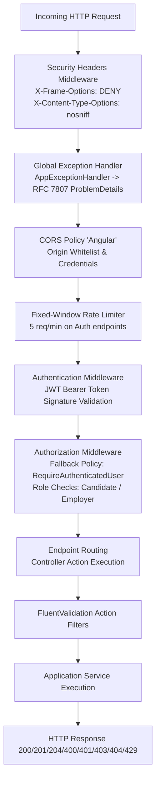
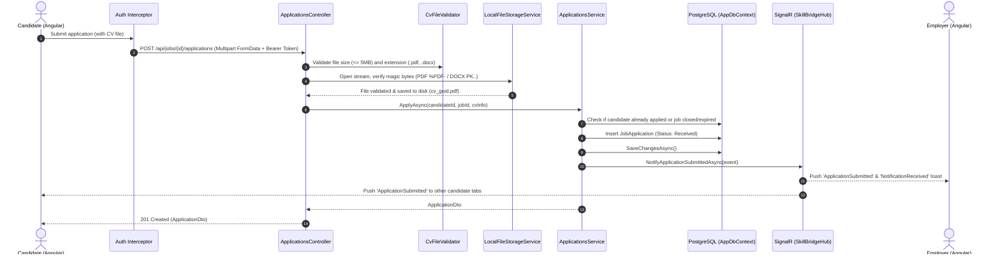

# 03. System Architecture

## 1. Overall System Architecture

SkillBridge is structured around a **Decoupled Client-Server Architecture** adhering strictly to **Clean Architecture** (Onion/Hexagonal) principles on the backend and **Component-Driven Standalone Reactive Architecture** on the frontend.

```mermaid
graph TB
    subgraph ClientLayer["Frontend Client Layer (Angular 21 SPA)"]
        UI["Standalone UI Components<br/>(Signals • SCSS Design Tokens • Reactive Forms)"]
        AuthInt["Auth Interceptor<br/>(Bearer Token Injection • CSRF Header Sync)"]
        RTClient["Realtime Service<br/>(@microsoft/signalr • WebSocket Client)"]
    end

    subgraph APILayer["Backend Host Layer (SkillBridge.Api)"]
        direction TB
        MW["Middleware Pipeline<br/>(Security Headers • CORS • RateLimiter • JwtBearer • ExceptionHandler)"]
        Controllers["API Controllers<br/>(Auth • Jobs • Applications • Profiles • Account)"]
        Hub["SignalR Hub (/hubs/app)<br/>(User Groups • Job Rooms)"]
        Worker["JobExpirationWorker<br/>(BackgroundService • 15s Timer)"]
    end

    subgraph AppLayer["Application Layer (SkillBridge.Application)"]
        direction TB
        Services["Application Services<br/>(JobsService • AuthService • MatchingService • ApplicationsService)"]
        Validators["FluentValidation Rules<br/>(Register • Login • JobCreate • ProfileUpdate)"]
        Interfaces["Abstractions & Interfaces<br/>(IAppDbContext • IRealtimeNotifier • IEmailService • IFileStorage)"]
    end

    subgraph DomainLayer["Domain Layer (SkillBridge.Domain)"]
        Entities["Domain Entities<br/>(Job • JobApplication • CandidateProfile • Skill • RefreshToken)"]
        Enums["Enums & Value Objects<br/>(ApplicationStatus • JobType • WorkArrangement • ExperienceLevel)"]
        BusinessRules["Domain Invariants & Exceptions<br/>(2-Hr Edit Rule • Status Transitions • Skill Limits)"]
    end

    subgraph InfraLayer["Infrastructure Layer (SkillBridge.Infrastructure)"]
        direction TB
        DbContext["AppDbContext (EF Core 10)<br/>(Relational Mappings • Fluent Configs • Migrations)"]
        Identity["Identity Services<br/>(AppUser • UserManager • JwtTokenService • RefreshTokenService)"]
        Email["BrevoEmailService<br/>(Transactional REST Client)"]
        Storage["LocalFileStorageService<br/>(Stream Validation • Magic Bytes)"]
    end

    subgraph DataStore["External & Persistence Layer"]
        Postgres[("PostgreSQL 16 Database<br/>(ACID Tables • Foreign Keys • Indexes)")]
        Disk[("Local Filesystem<br/>(Candidate CV Uploads: PDF/DOCX)")]
        BrevoCloud["Brevo Cloud API<br/>(Transactional Email Delivery)"]
    end

    UI --> AuthInt
    UI --> RTClient
    AuthInt -->|HTTP REST / ProblemDetails| MW
    RTClient <-->|WebSockets (WSS)| Hub
    MW --> Controllers
    Controllers --> Services
    Services --> Validators
    Services --> Interfaces
    Services --> Entities
    Services --> BusinessRules
    Interfaces -.->|Implemented by| InfraLayer
    DbContext --> Postgres
    Identity --> DbContext
    Storage --> Disk
    Email --> BrevoCloud
    Worker --> Services
    Services --> Hub
```

---

## 2. Backend Clean Architecture Layers

The backend solution (`backend/SkillBridge.sln`) is partitioned into four decoupled projects with unidirectional inward dependencies:

```
+--------------------------------------------------------------------+
|  SkillBridge.Api (Host, Controllers, Hubs, Middleware, Workers)    |
|   +--------------------------------------------------------------+ |
|   |  SkillBridge.Infrastructure (EF Core, Identity, Brevo, Disk) | |
|   |   +--------------------------------------------------------+ | |
|   |   |  SkillBridge.Application (Use Cases, Services, DTOs)   | | |
|   |   |   +--------------------------------------------------+ | | |
|   |   |   |  SkillBridge.Domain (Entities, Enums, Rules)     | | | |
|   |   |   +--------------------------------------------------+ | | |
|   |   +--------------------------------------------------------+ | |
|   +--------------------------------------------------------------+ |
+--------------------------------------------------------------------+
```

### Layer 1: `SkillBridge.Domain` (Core Domain)
- **Dependencies:** **Zero external dependencies.** Does not reference EF Core, ASP.NET Core, or third-party NuGet packages.
- **Responsibilities:**
  - Defines the core business entities: `Job`, `JobSkill`, `JobApplication`, `CandidateProfile`, `CandidateSkill`, `CandidateExperience`, `Skill`, `RefreshToken`.
  - Enforces domain invariants and encapsulates state mutations (e.g., `Job.IsEditingAllowed()`, `JobApplication.ChangeStatus()`, `CandidateProfile.UpdateSkills()`).
  - Defines business rule exceptions (`BusinessRuleException`).

### Layer 2: `SkillBridge.Application` (Business Logic & Use Cases)
- **Dependencies:** References `SkillBridge.Domain`, `FluentValidation`, and `Microsoft.EntityFrameworkCore` (for async LINQ extensions).
- **Responsibilities:**
  - Implements application use cases and orchestrators: `JobsService`, `AuthService`, `ApplicationsService`, `CandidateProfileService`, `JobMatchingService`, `SkillCatalogService`.
  - Defines boundary interfaces: `IAppDbContext`, `IIdentityService`, `IJwtTokenService`, `IRefreshTokenService`, `IRealtimeNotifier`, `IEmailService`, `IFileStorageService`, `IClock`.
  - Houses all request and response Data Transfer Objects (DTOs) and FluentValidation validators.

### Layer 3: `SkillBridge.Infrastructure` (Data Access & External Services)
- **Dependencies:** References `SkillBridge.Application`, `SkillBridge.Domain`, `Npgsql.EntityFrameworkCore.PostgreSQL`, `Microsoft.AspNetCore.Identity.EntityFrameworkCore`, `Microsoft.AspNetCore.Authentication.JwtBearer`.
- **Responsibilities:**
  - Manages EF Core 10 `AppDbContext`, table mappings, shadow properties, and migrations.
  - Implements `AppUser` (inheriting from `IdentityUser`) and manages Identity roles (`Candidate`, `Employer`).
  - Implements security services: `JwtTokenService`, `RefreshTokenService` with token family rotation.
  - Implements external boundary services: `BrevoEmailService`, `LocalFileStorageService`, `SystemClock`.

### Layer 4: `SkillBridge.Api` (Presentation & HTTP Gateway)
- **Dependencies:** References `SkillBridge.Application` and `SkillBridge.Infrastructure`.
- **Responsibilities:**
  - Configures dependency injection, environment options, and middleware pipeline in `Program.cs`.
  - Exposes RESTful API controllers with standard HTTP verbs and status codes.
  - Hosts the real-time SignalR hub (`SkillBridgeHub`) and dispatches push events via `SignalRNotifier`.
  - Hosts background hosted services: `JobExpirationWorker`.
  - Handles global exceptions via `AppExceptionHandler` producing standard RFC 7807 ProblemDetails.

---

## 3. Middleware Pipeline & Request Processing Flow

Every incoming HTTP request traverses an ordered ASP.NET Core middleware pipeline:



### Key Middleware Behaviors:
1. **Security Headers:** Every response is decorated with `X-Frame-Options: DENY` (clickjacking protection) and `X-Content-Type-Options: nosniff` (MIME sniffing prevention).
2. **CORS:** Configured to whitelist `http://localhost:4200` with `AllowCredentials()`, enabling secure transmission of cookies and authorization headers.
3. **Rate Limiting:** Protects sensitive endpoints (`/api/auth/login`, `/api/auth/social-login`) with an IP-partitioned fixed-window limiter (5 permits per 1-minute window). Exceeding requests receive HTTP 429 with a standard `Retry-After: 60` header.
4. **JWT Authentication & SignalR Query Hook:** Standard Bearer token authentication with a special hook for SignalR WebSockets: extracts the access token from the `?access_token=` query string for connections targeting `/hubs`.
5. **Authorization Fallback:** By default, every route requires an authenticated user (`RequireAuthenticatedUser`) unless decorated with `[AllowAnonymous]`.

---

## 4. Client-Server Communication & Data Flow

### The Complete Lifecycle of a Job Application



1. **Frontend Dispatch:** Candidate clicks "Submit Application" on `JobDetailComponent`. If attaching a new file, Angular constructs a `FormData` object.
2. **Interceptor Decoration:** `auth.interceptor.ts` intercepts the request, attaching `Authorization: Bearer <token>` and `X-XSRF-TOKEN` headers.
3. **Gateway Verification:** The API validates the JWT signature, extracts `ClaimTypes.NameIdentifier`, verifies the candidate role, and routes to `JobsController.Apply()`.
4. **File Validation:** `CvFileValidator` checks size limits. `LocalFileStorageService` inspects the stream's leading magic bytes to ensure malicious scripts disguised with `.pdf` extensions are rejected.
5. **Database Transaction:** `ApplicationsService` ensures the candidate has not already applied, verifies the job is currently open and not expired, creates the `JobApplication` entity, and persists it to PostgreSQL.
6. **Real-Time Notification:** `SignalRNotifier` dispatches real-time WebSocket payloads to the employer's private connection, the candidate's private connection, and the job room subscribers.
7. **Client Rendering:** The employer's applicants list dynamically appends the new applicant and updates the KPI counters without requiring a manual page refresh.

---

## 5. Frontend Architecture & Reactivity Model

The frontend application uses modern Angular 21 architecture:

```
frontend/src/app/
├── core/                  # Singleton services, guards, interceptors, models
│   ├── api/               # Low-level HTTP communication services
│   ├── guards/            # Functional route guards (authGuard, roleGuard)
│   ├── http/              # auth.interceptor.ts (bearer tokens, CSRF)
│   ├── models/            # TypeScript interfaces aligned with backend DTOs
│   ├── services/          # High-level stateful facade services
│   └── utils/             # Formatters, countdown timers, error mappers
├── features/              # Feature modules (lazy-loaded standalone components)
│   ├── account/           # Account security, password, email management
│   ├── auth/              # Login, register, forgot/reset password
│   ├── candidate/         # Job search, detail, onboarding, profile, applications
│   ├── employer/          # Jobs dashboard, post/edit job, applicants pipeline
│   └── landing/           # Cinematic marketing showcase & audience switcher
└── shared/                # Reusable UI components, pipes, and utility functions
    ├── components/        # Pagination, theme toggle, user profile menu
    └── utils/             # Salary parsers, date filters, department categorizers
```

### Signal-Based Reactivity
Components leverage Angular Signals (`signal`, `computed`) for local UI state:
- **`jobs = signal<JobDto[]>([])`**: Holds the current reactive job collection.
- **`searchQuery = signal<string>('')`**: Binds to input docks.
- **`filteredJobs = computed(() => ...)`**: Automatically re-evaluates whenever `jobs()`, `searchQuery()`, or active filter pills change, ensuring zero unnecessary change detection cycles.

