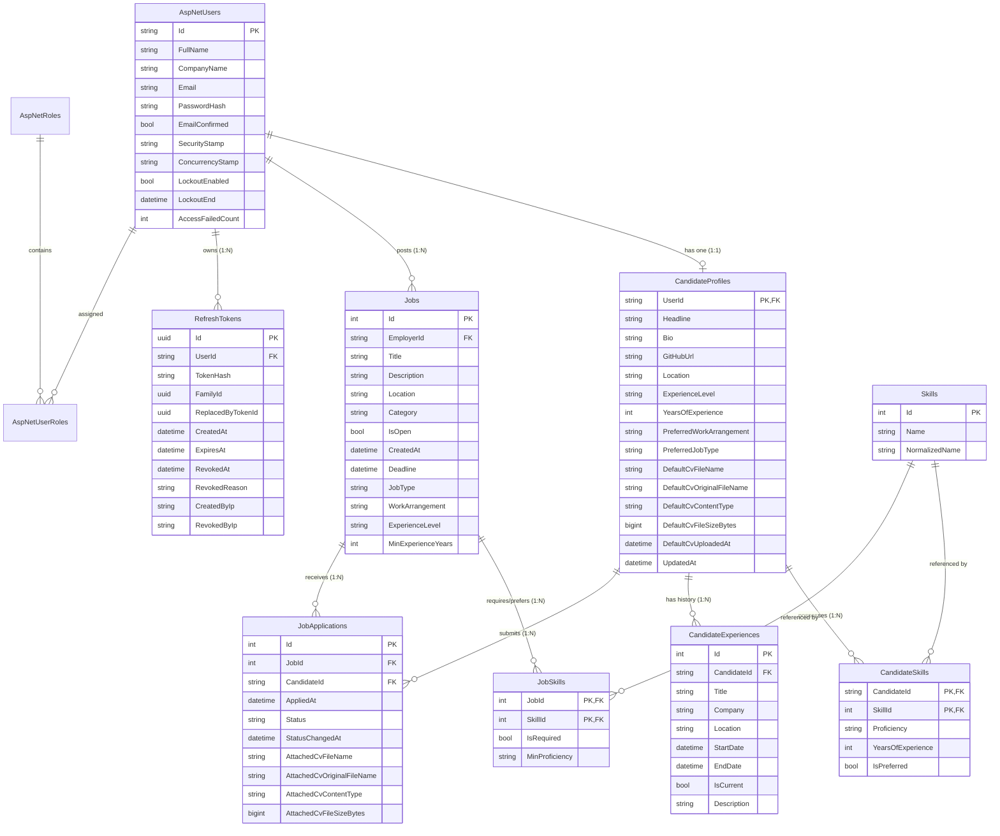

# 06. Database Documentation

## 1. Database Overview & Technology

The SkillBridge application persists all relational data in **PostgreSQL 16**, orchestrated via Docker Compose and managed within ASP.NET Core using **Entity Framework Core 10** (`Npgsql.EntityFrameworkCore.PostgreSQL`).

- **Database Engine:** PostgreSQL `16-alpine`
- **Port:** Local Host `5433` -> Container `5432`
- **Default Database Name:** `skillbridge`
- **ORM / Data Access:** Entity Framework Core 10 Code-First with fluent configuration classes
- **Naming Conventions:** Snake_case column mappings with standard PascalCase C# entity abstractions

---

## 2. Entity-Relationship Diagram (ERD)

---

## 3. Relational Table Schemas

### 1. `AspNetUsers` (Identity Users)
Stores credentials, core profile fields, and authentication metadata for both Candidates and Employers.
- `Id` (`text`, **Primary Key**): Unique GUID string generated on registration.
- `FullName` (`text`, Not Null): Display name of the user.
- `CompanyName` (`text`, Nullable): Populated for `Employer` accounts; null for `Candidate`.
- `Email` (`text`, Unique Index): User email address used for login and notifications.
- `NormalizedEmail` (`text`, Unique Index): Uppercase normalized email for collision checks.
- `PasswordHash` (`text`): PBKDF2 with HMAC-SHA256 hashed password.
- `EmailConfirmed` (`boolean`, Default `false`): Verification flag.
- `LockoutEnabled` (`boolean`, Default `true`): Protects against brute-force attacks.
- `AccessFailedCount` (`integer`, Default `0`): Failed login attempt counter.

### 2. `CandidateProfiles` (1:1 with `AspNetUsers`)
Stores candidate career preferences, experience summaries, and default CV file metadata.
- `UserId` (`text`, **Primary Key, Foreign Key -> AspNetUsers.Id**): Shared primary key ensuring strict 1:1 parity with the user account.
- `Headline` (`character varying(200)`, Nullable): Professional tagline (e.g. "Senior Full-Stack Engineer").
- `Bio` (`character varying(2000)`, Nullable): Summary description.
- `GitHubUrl` (`character varying(500)`, Nullable): Portfolio or code link.
- `Location` (`character varying(100)`, Nullable): City, Country or "Remote".
- `ExperienceLevel` (`text`, Nullable): Enum string (`EntryLevel`, `Junior`, `MidLevel`, `Senior`, `Lead`).
- `YearsOfExperience` (`integer`, Nullable): Total career experience in years.
- `PreferredWorkArrangement` (`text`, Nullable): Enum string (`Remote`, `Hybrid`, `OnSite`).
- `PreferredJobType` (`text`, Nullable): Enum string (`FullTime`, `PartTime`, `Contract`, `Internship`).
- `DefaultCvFileName` (`text`, Nullable): Internal sanitized GUID filename stored on disk.
- `DefaultCvOriginalFileName` (`text`, Nullable): User's original uploaded filename.
- `DefaultCvContentType` (`text`, Nullable): MIME type (`application/pdf`, `application/vnd.openxmlformats-officedocument.wordprocessingml.document`).
- `DefaultCvFileSizeBytes` (`bigint`, Nullable): File size in bytes.
- `DefaultCvUploadedAt` (`timestamp with time zone`, Nullable): Timestamp of upload.
- `UpdatedAt` (`timestamp with time zone`, Nullable): Last modification timestamp.

### 3. `CandidateSkills` (Many-to-Many Join with Attributes)
Stores the candidate's declared skills, proficiencies, and experience.
- `CandidateId` (`text`, **Composite PK, FK -> CandidateProfiles.UserId**): Cascades on profile delete.
- `SkillId` (`integer`, **Composite PK, FK -> Skills.Id**): Restrict on skill delete.
- `Proficiency` (`text`, Not Null): Enum string (`Beginner`, `Intermediate`, `Advanced`, `Expert`).
- `YearsOfExperience` (`integer`, Default `0`): Years practicing this skill.
- `IsPreferred` (`boolean`, Default `false`): Highlights candidate's primary focus skills.

### 4. `CandidateExperiences` (Work History Timeline)
Stores individual past or current employment positions for experience matching.
- `Id` (`integer`, **Primary Key, Serial Identity**).
- `CandidateId` (`text`, Not Null, **FK -> CandidateProfiles.UserId**): Cascades on delete.
- `Title` (`character varying(100)`, Not Null): Position title.
- `Company` (`character varying(100)`, Not Null): Company name.
- `Location` (`character varying(100)`, Nullable): Position location.
- `StartDate` (`timestamp with time zone`, Not Null): Employment start date.
- `EndDate` (`timestamp with time zone`, Nullable): Employment end date (null if `IsCurrent` is true).
- `IsCurrent` (`boolean`, Not Null, Default `false`): Flag for active role.
- `Description` (`character varying(2000)`, Nullable): Role responsibilities.

### 5. `Jobs` (Employer Job Postings)
Stores employer job vacancies, constraints, deadlines, and requirements.
- `Id` (`integer`, **Primary Key, Serial Identity**).
- `EmployerId` (`text`, Not Null, **FK -> AspNetUsers.Id**): Creator of the posting.
- `Title` (`character varying(150)`, Not Null): Role title.
- `Description` (`character varying(5000)`, Not Null): Complete role description and salary markers.
- `Location` (`character varying(100)`, Nullable): City, Country or "Remote".
- `Category` (`character varying(100)`, Nullable): Industry category (e.g. `Engineering`, `Healthcare`).
- `IsOpen` (`boolean`, Not Null, Default `true`): Active flag.
- `CreatedAt` (`timestamp with time zone`, Not Null): Post creation time.
- `Deadline` (`timestamp with time zone`, Nullable): Application deadline date.
- `JobType` (`text`, Not Null): Enum string (`FullTime`, `PartTime`, `Contract`, `Internship`).
- `WorkArrangement` (`text`, Not Null): Enum string (`Remote`, `Hybrid`, `OnSite`).
- `ExperienceLevel` (`text`, Not Null): Enum string (`EntryLevel`, `Junior`, `MidLevel`, `Senior`, `Lead`).
- `MinExperienceYears` (`integer`, Not Null, Default `0`): Minimum experience threshold.

### 6. `JobSkills` (Composite Join Entity: Requirements & Preferences)
Defines whether a skill is required or preferred, and specifies the minimum proficiency.
- `JobId` (`integer`, **Composite PK, FK -> Jobs.Id**): Cascades on job delete.
- `SkillId` (`integer`, **Composite PK, FK -> Skills.Id**): Restrict on delete.
- `IsRequired` (`boolean`, Not Null, Default `true`): `true` = Must-Have (50-65% weight); `false` = Nice-To-Have (+15% bonus).
- `MinProficiency` (`text`, Not Null, Default `'Intermediate'`): Minimum proficiency threshold.

### 7. `JobApplications` (Candidate Applications)
Stores candidate applications and maintains the hiring pipeline status.
- `Id` (`integer`, **Primary Key, Serial Identity**).
- `JobId` (`integer`, Not Null, **FK -> Jobs.Id**): Cascades on job delete.
- `CandidateId` (`text`, Not Null, **FK -> CandidateProfiles.UserId**): Cascades on profile delete.
- `AppliedAt` (`timestamp with time zone`, Not Null): Application timestamp.
- `Status` (`text`, Not Null, Default `'Received'`): Enum string (`Received`, `Shortlisted`, `Rejected`, `Withdrawn`).
- `StatusChangedAt` (`timestamp with time zone`, Nullable): Timestamp of latest status transition.
- `AttachedCvFileName` (`text`, Nullable): Stored file GUID on disk.
- `AttachedCvOriginalFileName` (`text`, Nullable): Uploaded filename.
- `AttachedCvContentType` (`text`, Nullable): MIME type.
- `AttachedCvFileSizeBytes` (`bigint`, Nullable): File size in bytes.
- **Unique Constraint:** `(JobId, CandidateId)` ensures a candidate cannot apply to the same job multiple times.

### 8. `Skills` (Standardized Taxonomy)
Curated vocabulary of professional competencies.
- `Id` (`integer`, **Primary Key, Serial Identity**).
- `Name` (`character varying(100)`, Not Null): Display name (e.g. `ASP.NET Core`, `TypeScript`).
- `NormalizedName` (`character varying(100)`, Not Null, **Unique Index**): Uppercase trimmed string (`ASP.NET CORE`).

### 9. `RefreshTokens` (Session & Token Rotation)
Stores cryptographically hashed refresh tokens with family tracking for reuse detection.
- `Id` (`uuid`, **Primary Key**): Token GUID.
- `UserId` (`text`, Not Null, **FK -> AspNetUsers.Id**): Token owner.
- `TokenHash` (`text`, Not Null, **Unique Index**): SHA-256 hex hash of the raw token.
- `FamilyId` (`uuid`, Not Null, **Index**): Tracks the lifetime of a login session across rotations.
- `ReplacedByTokenId` (`uuid`, Nullable): Points to the replacement token upon successful rotation.
- `CreatedAt` (`timestamp with time zone`, Not Null).
- `ExpiresAt` (`timestamp with time zone`, Not Null).
- `RevokedAt` (`timestamp with time zone`, Nullable): Null if active.
- `RevokedReason` (`text`, Nullable): e.g. `Rotated`, `Logout`, `RevokedDueToTokenReuseDetection`.
- `CreatedByIp` (`text`, Nullable).
- `RevokedByIp` (`text`, Nullable).

---

## 4. EF Core Migrations History

All schema changes are tracked via sequential EF Core migrations located in `backend/src/SkillBridge.Infrastructure/Persistence/Migrations/`:

1. `20261005113719_InitialMigration`: Creates initial Identity tables, `Skills`, `CandidateProfiles`, `CandidateSkills`, `Jobs`, `JobSkills`, and `JobApplications`.
2. `20261005125540_RemoveUnusedRefreshTokens`: Prunes legacy token schema in preparation for RFC 6819 structure.
3. `20261102190324_ImproveJobMatchingAlgorithm`: Introduces `MinProficiency` and `IsRequired` columns on `JobSkills` to support multi-factor matching.
4. `20261102195906_AddCandidateSkillIsPreferred`: Adds `IsPreferred` flag to `CandidateSkills`.
5. `20261105201847_AddJobDeadline`: Adds `Deadline` timestamp column to `Jobs`.
6. `20261106192755_AddRefreshTokensTable`: Establishes the dedicated `RefreshTokens` table with `FamilyId`, `TokenHash`, and IP tracking.
7. `20261106203359_AddCvFieldsToApplications`: Adds attached CV metadata columns (`AttachedCvFileName`, etc.) to `JobApplications`.
8. `20261107194004_AddDefaultCvToCandidateProfile`: Adds default CV metadata columns to `CandidateProfiles`.
9. `20261109202540_MakeCandidateProfilePreferencesNullable`: Relaxes candidate preference columns to nullable to support incremental onboarding.
10. `20261110204532_AddJobCategory`: Adds `Category` column to `Jobs` for multi-industry filtering.

