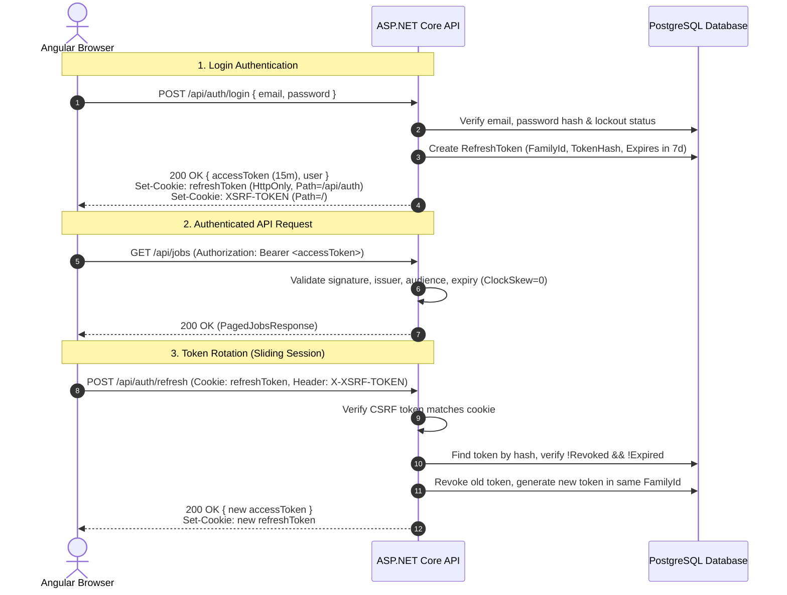

# 08. Authentication & Security

## 1. Authentication Architecture

SkillBridge implements a modern, defense-in-depth security model combining stateless **JSON Web Tokens (JWT)** for rapid API request authorization with stateful, database-tracked **Sliding Refresh Tokens** for persistent session management.

---

## 2. Token Specifications & Cryptography

### 1. Access Token (JWT)
- **Algorithm:** `HMAC-SHA256` (`SecurityAlgorithms.HmacSha256`).
- **Signature Key:** Configured via `Jwt:Key` in `appsettings.json` (must be at least 256 bits).
- **Issuer / Audience:** Validated strictly against configured `Jwt:Issuer` and `Jwt:Audience`.
- **Expiration:** Default `15 minutes`.
- **Clock Skew:** Configured to `TimeSpan.Zero` (`options.TokenValidationParameters.ClockSkew = TimeSpan.Zero`), preventing token acceptance past exact expiration.
- **Claims Stored in Token:**
  - `sub` / `nameid`: Unique User Identifier GUID.
  - `name`: User's Full Name.
  - `email`: User's Email Address.
  - `role`: Role string (`Candidate` or `Employer`).
  - `jti`: Unique token GUID.

### 2. Refresh Token & RFC 6819 Token Rotation
Refresh tokens follow the enterprise guidance of **RFC 6819 Section 5.2.2.3** (Refreshing an Access Token):
- **Raw Token Generation:** 64 bytes of cryptographically secure random bytes generated via `RandomNumberGenerator.GetBytes(64)` and Base64-encoded.
- **Storage:** Only the SHA-256 hash (`TokenHash`) is stored in PostgreSQL. If the database is compromised, active refresh tokens cannot be reversed.
- **Single-Use Sliding Expiration:** Each refresh token can be exchanged **exactly once**. Successful rotation issues a new token and revokes the old one with reason `"Rotated"`.
- **Automatic Reuse Detection & Compromise Revocation:**
  - Every token belongs to a persistent `FamilyId` (representing a specific login session).
  - If a client attempts to refresh using a token that has **already been revoked**, the system infers that an attacker intercepted or replayed a token.
  - The backend immediately executes a cascading revocation of **all tokens sharing that `FamilyId`**, terminating all sessions for that device.
  - Rejects with `401 Unauthorized` (`auth.refresh_token_reuse`).

---

## 3. Cookie & Anti-CSRF Security Model

SkillBridge employs a dual-cookie architecture to prevent Cross-Site Scripting (XSS) token theft while neutralizing Cross-Site Request Forgery (CSRF):

### 1. Refresh Token Cookie (`refreshToken`)
- `HttpOnly = true`: Inaccessible to JavaScript `document.cookie`, preventing XSS extraction.
- `Secure = true` (in HTTPS): Only transmitted over encrypted connections.
- `SameSite = SameSiteMode.Lax`: Mitigates cross-site request forgery while allowing top-level navigation.
- `Path = /api/auth`: Restricted exclusively to auth routes; never transmitted on standard data requests.

### 2. Anti-CSRF Cookie (`XSRF-TOKEN`) & Header (`X-XSRF-TOKEN`)
- The server sets a readable `XSRF-TOKEN` cookie upon login/registration.
- State-changing unauthenticated endpoints requiring cookies (`/api/auth/refresh`, `/api/auth/logout`) require the client to mirror this value in the custom HTTP header `X-XSRF-TOKEN`.
- The server's `ValidateCsrfToken()` method verifies that the header value matches the cookie value before processing the request. Because cross-site attackers cannot read the cookie from another domain, they cannot forge the required header.

---

## 4. Rate Limiting & Brute-Force Mitigation

### Implemented via ASP.NET Core RateLimiter Middleware:
- **Policy:** `"LoginRateLimit"` configured in `Program.cs`.
- **Target Endpoints:** `POST /api/auth/login` and `POST /api/auth/social-login`.
- **Algorithm:** Fixed Window Limiter.
- **Limit:** 5 permits per 1-minute window per IP partition.
- **Partition Key:** Resolves `X-Forwarded-For` header or fallback `RemoteIpAddress`.
- **Rejection Behavior:** Returns HTTP `429 Too Many Requests` with:
  - Header: `Retry-After: 60`
  - ProblemDetails JSON: `"Maximum login attempts exceeded. Please try again in 1 minute."`

### Account Lockout:
- Integrated with ASP.NET Core Identity's `LockoutEnabled = true`.
- Repeated failed login attempts increment `AccessFailedCount` and trigger temporary account lockout (`423 Locked`), preventing dictionary attacks.

---

## 5. Defense Against OWASP Top 10 Vulnerabilities

| Vulnerability | Status | Mitigation Technique Implemented in SkillBridge |
| :--- | :--- | :--- |
| **SQL Injection** | **Fully Mitigated** | All database operations use Entity Framework Core 10 LINQ queries, which compile to fully parameterized SQL statements via `Npgsql`. No raw dynamic string-concatenated SQL queries exist in the codebase. |
| **Cross-Site Scripting (XSS)** | **Fully Mitigated** | 1. Angular template engine automatically escapes all untrusted interpolated values (`{{ ... }}`). 2. Sensitive refresh tokens are stored in `HttpOnly` cookies. 3. HTTP response headers enforce `X-Content-Type-Options: nosniff`. |
| **Cross-Site Request Forgery (CSRF)** | **Fully Mitigated** | Double-submit CSRF cookie pattern enforced on refresh and logout endpoints (`XSRF-TOKEN` cookie + `X-XSRF-TOKEN` header verification). |
| **Clickjacking** | **Fully Mitigated** | Global middleware applies `X-Frame-Options: DENY` to every HTTP response, prohibiting iframe embedding. |
| **Insecure File Uploads** | **Fully Mitigated** | `CvFileValidator` enforces a 5 MB ceiling and `.pdf` / `.docx` extension whitelist. `LocalFileStorageService` reads the input stream and verifies magic-byte file signatures (`%PDF-` and `PK\x03\x04`), neutralizing disguised executables or scripts. |
| **Broken Object Level Auth (BOLA / IDOR)** | **Fully Mitigated** | Controllers enforce strict ownership checks before modifying resources (e.g. `EmployerJobsController` verifies `job.IsOwnedBy(userId)`; `CandidateApplicationsController` filters queries by the authenticated user's ID). |
| **Brute-Force Credential Stuffing** | **Fully Mitigated** | IP-partitioned fixed-window rate limiting on login routes plus Identity account lockout. |

---

## 6. Security Implementation Status Audit

### What is Fully Implemented:
- [x] JWT Bearer authentication with signature, issuer, audience, and zero clock-skew validation.
- [x] RFC 6819 refresh token rotation with family reuse detection and automatic session revocation.
- [x] HttpOnly, Secure, Lax cookie encapsulation for refresh tokens.
- [x] Double-submit CSRF validation on refresh and logout routes.
- [x] Password hashing using ASP.NET Core Identity PBKDF2 with HMAC-SHA256.
- [x] IP-partitioned rate limiting on authentication routes.
- [x] Magic-byte inspection on document uploads.
- [x] Security response headers (`X-Frame-Options: DENY`, `X-Content-Type-Options: nosniff`).
- [x] CORS origin whitelisting (`http://localhost:4200`) with credential allowance.
- [x] Multi-device session revocation (`/api/account/logout-all`).

### What is Partially Implemented / Requires Production Hardening:
- [ ] **Reverse Proxy Partitioning:** Rate limiter partition key uses `X-Forwarded-For` without validating proxy trust (`ForwardedHeadersOptions`), which could allow spoofing if deployed behind an unconfigured proxy.
- [ ] **Content Security Policy (CSP):** While `X-Frame-Options` and `X-Content-Type-Options` are active, a dedicated `Content-Security-Policy` header has not yet been configured in middleware.
- [ ] **Token Storage in Client Memory:** Angular stores the access token in memory (`signal<string | null>`). While secure against XSS persistence, full page reloads trigger a background refresh handshake.

