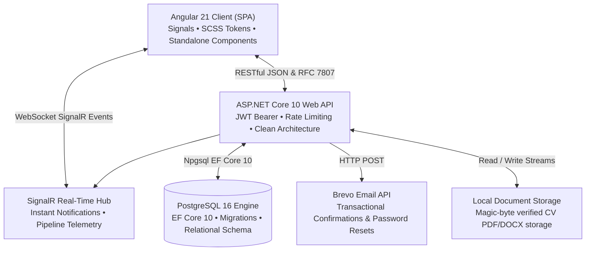

# SkillBridge — Technical Documentation & Architecture Reference

Welcome to the comprehensive technical documentation for **SkillBridge**, an enterprise-grade, skills-first talent matching and job acquisition platform. This documentation suite provides an exhaustive, source-grounded reference covering the full-stack architecture, backend services, frontend applications, database models, security mechanisms, API specifications, and developer maintenance workflows.

---

## Documentation Navigation Matrix

The technical documentation is divided into 17 specialized modules:

| Document | Focus Area | Key Topics Covered |
| :--- | :--- | :--- |
| [**01. Project Overview**](./01-project-overview.md) | High-Level Overview | Core mission, problem statement, dual-sided user personas, high-level business workflow, and platform value proposition. |
| [**02. Technology Stack**](./02-technology-stack.md) | Dependencies & Runtimes | Detailed catalog of all frameworks, libraries, versions, selection justifications, and integration boundaries. |
| [**03. System Architecture**](./03-system-architecture.md) | Architecture & Diagrams | Clean Architecture layers, standalone Angular architecture, SignalR real-time hubs, and end-to-end data flow Mermaid diagrams. |
| [**04. Frontend Documentation**](./04-frontend-documentation.md) | Angular Client Architecture | Standalone components, signals reactivity, route trees, guards, HTTP interceptors, SCSS design token systems, and responsive layouts. |
| [**05. Backend Documentation**](./05-backend-documentation.md) | ASP.NET Core Web API | Clean Architecture projects, controllers, application services, middleware pipeline, background workers, and RFC 7807 error formats. |
| [**06. Database Documentation**](./06-database-documentation.md) | PostgreSQL & EF Core | Relational schema, composite primary keys, foreign key cascading, indexes, migration histories, and Mermaid ERD. |
| [**07. Feature Documentation**](./07-feature-documentation.md) | Complete Feature Catalog | 14 end-to-end feature implementations with step-by-step lifecycles, UI controls, backend logic, and validation rules. |
| [**08. Authentication & Security**](./08-authentication-and-security.md) | Platform Security Posture | JWT bearer tokens, RFC 6819 refresh token rotation with family reuse detection, double-submit CSRF cookies, and OWASP Top 10 mitigation. |
| [**09. API Reference**](./09-api-reference.md) | REST API Specification | Exhaustive endpoint documentation for all 26+ endpoints with HTTP methods, auth requirements, payloads, and response status codes. |
| [**10. User Roles & Permissions**](./10-user-roles-and-permissions.md) | Access Control & Matrix | Candidate vs. Employer authorization matrices, route guard enforcement, and controller-level role policies. |
| [**11. Installation & Configuration**](./11-installation-and-configuration.md) | Local Setup & Environment | Step-by-step developer environment setup, PostgreSQL configuration, database migrations, seed data, and documented `.env.example`. |
| [**12. Deployment & Production**](./12-deployment-and-production.md) | Infrastructure & Hosting | Production compilation, Docker containerization, reverse proxy setups, persistent storage for CV uploads, and SSL/TLS configuration. |
| [**13. Error Handling & Logging**](./13-error-handling-and-logging.md) | Resilience & Telemetry | RFC 7807 ProblemDetails contracts, backend exception hierarchy, frontend toast interceptors, and logging strategies. |
| [**14. Testing & Code Quality**](./14-testing-and-code-quality.md) | Test Suites & Quality Assurance | Vitest frontend suite (200 passing unit tests), backend xUnit integration tests, and static analysis standards. |
| [**15. Technical Debt & Risks**](./15-technical-debt-and-recommendations.md) | Technical Review & Roadmap | Prioritized analysis (Critical, High, Medium, Low) of architectural bottlenecks, storage refactoring, and scalability paths. |
| [**16. Project Directory Reference**](./16-project-directory-reference.md) | Codebase Map | File-by-file directory explanation detailing the exact purpose and responsibilities of every folder and core file. |
| [**17. Developer Learning Guide**](./17-developer-learning-guide.md) | Developer Onboarding | Practical walkthroughs: tracing requests, adding pages, implementing endpoints, creating migrations, and safe debugging. |

---

## Executive Summary

SkillBridge replaces keyword-based resume scanning with a **deterministic, skills-matched algorithmic engine**. Candidates register verified skills, proficiencies, and career preferences, while employers define required and preferred technical competencies with minimum proficiency thresholds. The platform continuously computes dynamic compatibility ratings (0–100%) and powers a live hiring pipeline with bidirectional real-time telemetry over WebSockets (SignalR).

### Core Technical Pillars



1. **Frontend Architecture:** Modern Angular 21 utilizing signal-based state reactivity, standalone components, lazy-loaded routing, custom SCSS design token theming (Light / Dark / System), and Vitest test runner.
2. **Backend Architecture:** Clean Architecture with ASP.NET Core 10 (`net10.0`), C# 13, Entity Framework Core 10 with Npgsql, ASP.NET Core Identity, and FluentValidation.
3. **Real-Time Synchronization:** SignalR Hub (`/hubs/app`) managing role-specific groups and job-specific rooms for instantaneous applicant notifications and status transitions.
4. **Resilient Security:** Double-cookie authentication (HttpOnly refresh token + double-submit CSRF cookie), sliding refresh token rotation with family revocation on reuse, client-side IP-partitioned rate limiting, and magic-byte file signature validation.

---

## Getting Started Quickly

To launch the entire platform locally in development mode:

```bash
# 1. Start PostgreSQL via Docker Compose
docker compose up -d

# 2. Run Backend API & Automatic Database Migrations
cd backend/src/SkillBridge.Api
dotnet run

# 3. In a separate terminal, run Frontend Angular Client
cd frontend
npm start
```

- **Frontend Application:** `http://localhost:4200`
- **Backend API Base:** `http://localhost:5000` or `https://localhost:5001`
- **Interactive OpenAPI Scalar Docs:** `http://localhost:5000/scalar/v1`
- **Swagger UI:** `http://localhost:5000/swagger`

Consult [**11. Installation & Configuration**](./11-installation-and-configuration.md) for full setup instructions, connection strings, and default seed credentials.

